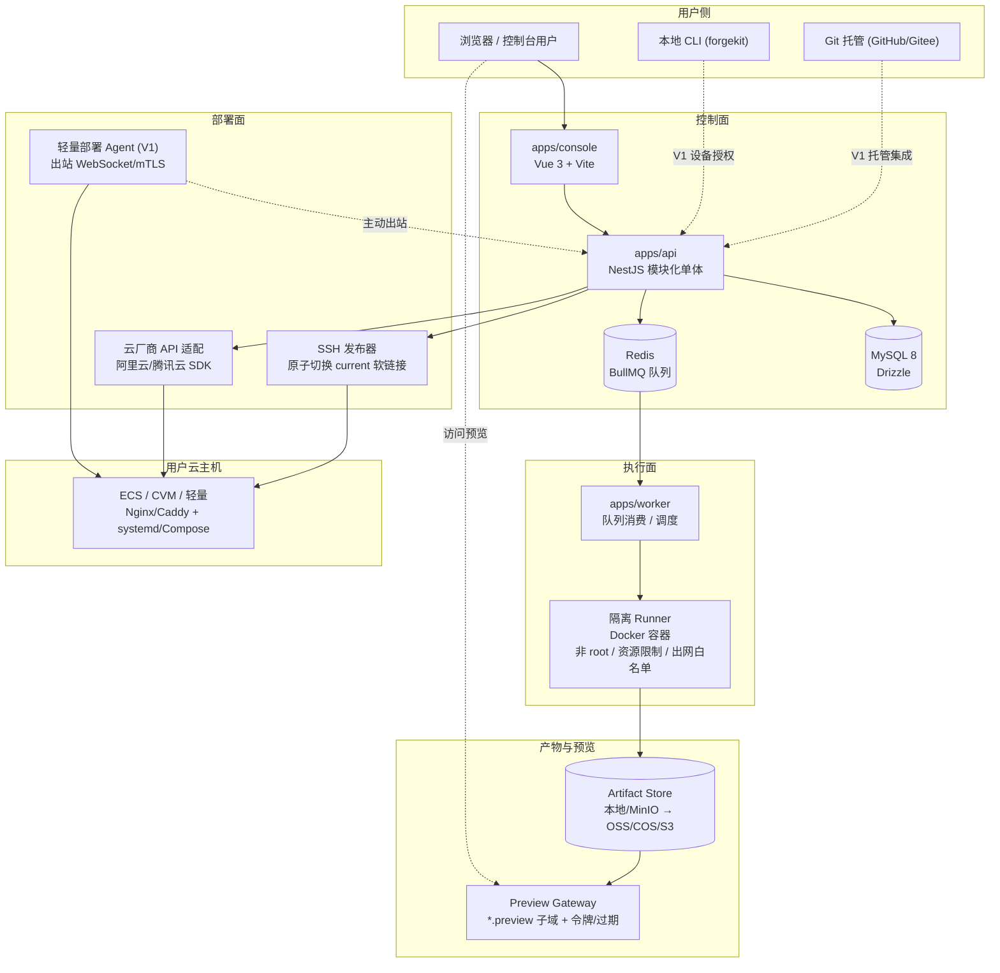
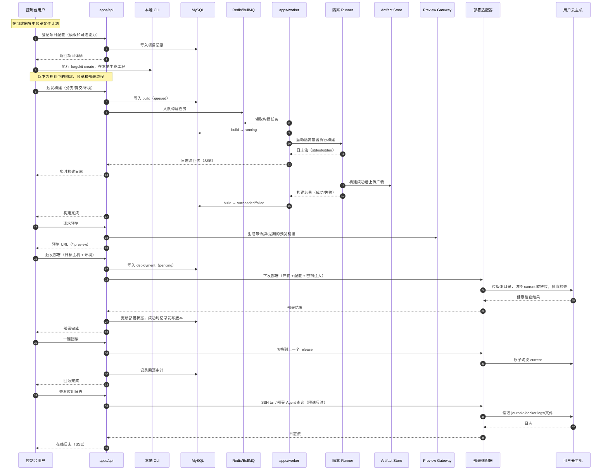

# YKForgeKit 技术架构规划

> 状态：草案（Proposed）
>
> 日期：2026-11-19
>
> 本文档为规划，不代表功能已实现；现状以代码和各功能文档为准。已实现能力可参考 [../project-members.md](../project-members.md)、[../../adr/0004-identity-authorization-foundation.md](../../adr/0004-identity-authorization-foundation.md)、[../../architecture/blueprint.zh-CN.md](../../architecture/blueprint.zh-CN.md) 等文档。

## 1. 架构总览

YKForgeKit 的目标是提供「从想法到上线」的一体化平台：模板/资产生成标准工程 → 云端构建 → 预览 → 一键发布到用户自己的阿里云/腾讯云主机 → 在线日志运维。整体遵循蓝图原则：**成熟稳定优先、模块化单体、不立即引入微服务/K8s/服务网格**；控制面与执行面强隔离；生成的项目是标准工程，可脱离平台独立维护。

### 1.1 分层视图

以下为目标架构。当前控制面已支持身份、项目登记、成员和资产等基础能力，其余按路线图分阶段交付。

- **控制面（Control Plane）**：[apps/api](../../../apps/api)（NestJS 模块化单体）+ [apps/console](../../../apps/console)（Vue 3 控制台）。负责身份、项目、成员、资产、构建/部署编排、日志查询、审计。控制面持有业务数据库（MySQL 8），**不直接执行用户代码**。
- **执行面（Execution Plane）**：`apps/worker`（BullMQ 消费者/调度器）+ 隔离 Runner（Docker 容器）。Runner 只接收构建任务描述与产物上传凭证，**不能访问控制面数据库**，出网受白名单限制。
- **产物与预览**：Artifact Store（MVP 本地磁盘/MinIO，后续阿里云 OSS/腾讯云 COS/S3 兼容）+ Preview Gateway（按项目+构建号提供带令牌/过期的静态预览）。
- **部署面（Deploy Plane）**：Deploy Adapters（SSH 发布器、云厂商 API 适配）+ 可选轻量部署 Agent（V1，主动出站连接）。部署目标是**用户自己的云主机**，平台不托管用户云资源费用。
- **用户环境**：阿里云 ECS / 腾讯云 CVM / 轻量应用服务器，Nginx/Caddy 托管静态站或反向代理 Node 服务，systemd 或 Docker Compose 管理进程。

### 1.2 架构图

> 说明：图中 `apps/worker` 的 BullMQ 编排与构建 API 已由 [B08](../worker-build-queue.md) 实现；[B09](../docker-build-runner.md) 提供 Docker Runner 和本地 ArtifactStore（暂位于 worker，首次外部复用时再评估独立包）。Preview Gateway、Deploy Adapters、部署 Agent 仍为**规划中**；源码目前仅支持模板重建，生产 registry 白名单需宿主网络落实。

## 2. 与现有 monorepo 的映射

### 2.1 现有模块复用与新增目录

| 路径 | 现状 | 本规划中的角色 | 需新增/扩展 |
| --- | --- | --- | --- |
| [apps/console](../../../apps/console) | 已实现项目列表、详情、资产中心、OIDC 和个人资料。创建向导预览文件计划并调用 API 登记项目，工程文件由本地 CLI 生成 | 控制台前端 | 新增构建、预览、部署、日志、环境变量、主机管理页面；非技术用户模式向导（V1） |
| [apps/api](../../../apps/api) | 已实现：health/ready、auth、projects、assets、members、invitations | 控制面单体 | 新增 Builds / Deployments / Environments / Hosts / Secrets / Logs 模块；网关限流 |
| [packages/contracts](../../../packages/contracts) | 已实现：DTO、asset-verification 报告、targets 枚举 | 共享契约 | 扩展 Build/Deployment/Environment/LogStream/Secret/Host DTO；沿用现有目标端枚举，用模板元数据标识 uni-app、Tauri 等实现方案 |
| [packages/project-core](../../../packages/project-core) | 已实现：纯函数生成，仅 `vue-web` 模板 | 模板注册表与生成 | 重构为模板注册表（元数据：类型/目标端/能力）；新增 nuxt-site、vue-admin、uni-app、tauri-desktop、nest-api 等模板（分批） |
| [packages/asset-core](../../../packages/asset-core) | 已实现：Registry/Resolver/Installer Planner、official.theme、锁文件、漂移检测 | 资产协议 | 推广到多 target；新增 uni-app/tauri target 资产；AI 提案复用 Installer Planner 的计划/确认模式 |
| [packages/cli](../../../packages/cli) | 已实现：create / asset list/plan/add/upgrade/remove/verify | 本地 CLI | 新增本地构建/部署、设备授权登录（V1） |
| [packages/identity-core](../../../packages/identity-core) | 已实现：OIDC 验证 + 纯授权策略（owner/editor/viewer） | 身份与授权 | 新增权限：`build:run`、`deploy:*`、`secret:write`、`log:read` 等；组织/团队（V1） |
| [packages/db](../../../packages/db) | 已实现：MySQL 8 + Drizzle，迁移 0000–0010；B07 数据基础与 B08/B11 审计 | 数据访问 | 后续新增 releases、secrets、log_streams 等，并按 B12–B15 扩展部署模型 |
| `apps/worker` | B08 BullMQ + 状态机；B09 可选 Docker Runner 与本地制品，默认 noop | 队列消费/调度 | B10 实时日志；后续保留期/清理策略 |
| `apps/agent` | 待建 | 轻量部署 Agent（V1） | 新建：单二进制，出站 WebSocket/HTTPS，mTLS + 一次性注册令牌 |
| `adapters/deploy-ssh` | 待建 | SSH 发布器 | 新建：原子切换 current 软链接、Caddy 配置、健康检查、回滚 |
| `adapters/deploy-aliyun` | 待建 | 阿里云 API 适配（V1） | 新建：实例列表、云助手、安全组、DNS、证书 |
| `adapters/deploy-tencent` | 待建 | 腾讯云 API 适配（V1） | 新建：CVM、TAT、安全组、DNSPod、证书 |
| `adapters/build-web` | 待建 | Web 构建适配 | 新建：pnpm install/build、产物收集 |
| `adapters/build-uniapp` | 待建 | uni-app 构建（V1） | 新建：H5/小程序构建、miniprogram-ci/minidev 上传 |
| `adapters/artifact-store` | B09 接口与本地实现暂在 worker；独立包待真实外部复用时评估 | 产物存储抽象 | 后续 MinIO/OSS/COS/S3 适配 |
| `apps/api` 的 `preview-main` 独立进程 | 已实现 B11 | 预览网关 | 独立 origin、每链接 host、令牌/过期/撤销；见 [预览指南](../preview-links.md) |
| `apps/worker` 内 Runner 镜像 | B09 默认预拉取可信 node:22，参数强制非 root/只读/资源限制，无自定义 Dockerfile | 隔离 Runner | 生产固定镜像 digest；宿主落实 registry 出口，后续更强 runtime |

### 2.2 复用原则

- **契约先行**：所有跨进程/跨模块交互（控制面 ↔ worker ↔ runner ↔ adapters）通过 [packages/contracts](../../../packages/contracts) 定义 DTO，避免隐式耦合。
- **纯逻辑下沉**：模板生成、资产计划、授权策略保持纯函数（`project-core`、`asset-core`、`identity-core`），便于单测与复用。
- **适配器隔离**：云厂商、存储、构建、部署均以 adapter 形式实现，控制面只依赖接口，便于替换与私有化部署。
- **不破坏现有 API**：新增模块走独立路由前缀（如 `/projects/:slug/builds`），现有接口保持兼容。

## 3. 关键技术选型及理由与取舍

### 3.1 Web 模板

| 场景 | 推荐 | 备选 | 不选理由 |
| --- | --- | --- | --- |
| SPA / 后台管理 | Vue 3 + Vite + TS + Pinia + Vue Router | — | 与现有 `vue-web` 模板一致，生态成熟 |
| 官网/博客（SEO） | Nuxt（SSR/SSG） | VitePress（纯文档） | VitePress 不适合通用官网/博客；Nuxt 与 Vue 生态一致 |
| 后台组件库 | Element Plus | Naive UI | Element Plus 生态更大、中文资料多、企业后台案例多；Naive UI 作为备选保留 |
| 工具站 | Vue 3 + Vite SPA | — | 轻量、部署简单 |

**推荐组合**：到 MVP 完成时共支持 3–4 个 Web 模板——Vue 后台管理（Element Plus）、个人站/博客（Nuxt SSG）、企业官网（Nuxt SSG）、Vue SPA 工具站。

### 3.2 跨端方案深度对比

| 方案 | 语言 | Vue 复用 | 小程序覆盖 | iOS/Android | 桌面 | 性能 | 生态与风险 |
| --- | --- | --- | --- | --- | --- | --- | --- |
| **uni-app**（Vue 3 + Vite） | Vue/TS | 高 | 微信/支付宝/抖音/百度/QQ/快手/京东/飞书等 | 支持（App 端） | 不支持 | 中（WebView 渲染为主，uni-app x 原生渲染待评估） | DCloud 生态锁定风险；国内小程序覆盖最广 |
| Taro | React 优先 | 中（Vue 3 支持次之） | 多平台 | 支持 | 不支持 | 中 | 与 Vue 路线不完全契合 |
| **Tauri 2** | Rust + Web | 高（复用 Vue Web/H5 构建） | 不支持 | 移动端支持但非主力 | 支持（Win/macOS/Linux） | 高（体积小、原生 WebView） | Rust 学习曲线；移动端生态较新 |
| Capacitor | Web + 原生桥 | 高 | 不支持 | 支持 | 不支持 | 中 | 适合 Web 优先轻应用，作为可选目标 |
| Electron | Web + Node | 高 | 不支持 | 不支持 | 支持 | 中（体积大） | 成熟但体积大；需要 Node 深度集成时备选 |
| Flutter | Dart | 无 | 不支持 | 支持 | 支持 | 高 | 不能复用 Vue 资产 |
| React Native | React | 无 | 不支持 | 支持 | 不支持 | 高 | 非 Vue |

**明确推荐组合**：
- **小程序 + 移动 App + H5**：uni-app（Vue 3 + Vite）作为主力「一套代码」方案；App 端可选 uni-app x（原生渲染）以后再评估。
- **桌面（Windows/macOS/Linux）**：Tauri 2 + Vue，复用 Vue Web/H5 构建；需要 Node 生态深度集成时 Electron 作备选。
- **Web**：Vue 3 + Vite（SPA/后台）；SEO 场景用 Nuxt。
- **共享**：TS 业务逻辑包 + 设计 Token。
- 跨端共享以业务逻辑和设计 Token 为主，UI 按目标端适配。

### 3.3 构建 Runner 与沙箱

- **推荐**：Docker 容器 Runner，非 root、资源限制（CPU/内存/磁盘/超时）、只读基础镜像、无控制面数据库访问、出网白名单（仅允许 npm registry、Git 托管、云厂商 API 等必要域名）。
- **后续评估**：gVisor / Kata Containers / firecracker 等更强隔离方案。
- **平台覆盖**：Linux Runner 在 MVP 构建 Web 产物，V1 扩展至 H5 和小程序。V2+ 评估 Android 和 Windows 构建，iOS/macOS 使用 macOS Runner（自建 Mac mini 或云 Mac）。
- **不选理由**：MVP 不引入 K8s/服务网格（蓝图原则）；不直接在主控机执行用户代码。

### 3.4 队列

- **推荐**：BullMQ + Redis。成熟、Node 生态好、支持延迟/重试/优先级/并发控制，与 NestJS 集成简单。
- **备选**：RabbitMQ（更重）、云厂商消息队列（绑定云）。
- **不选理由**：MVP 不需要复杂路由；BullMQ 足够且运维简单。

### 3.5 产物存储

- **MVP**：本地磁盘或 MinIO（S3 兼容），通过 `adapters/artifact-store` 抽象。
- **后续**：阿里云 OSS / 腾讯云 COS / S3 兼容。
- **理由**：抽象先行，避免绑定单一云；私有化部署可用 MinIO。

### 3.6 预览环境

- **MVP**：静态产物预览——构建产物上传至预览存储，通过 `*.preview` 子域按项目+构建号访问，带访问令牌/过期时间。
- **V1**：带后端的容器预览环境（PR/分支预览，闲置自动回收）。
- **V1：H5 与小程序预览**：H5 预览 + 小程序体验版二维码（微信 CI 预览）。

### 3.7 部署

- **MVP：SSH 发布器**（平台无关，适用阿里云 ECS、腾讯云 CVM、轻量应用服务器）：
  - 上传产物到 `releases/<id>` 目录，原子切换 `current` 软链接；
  - 使用 Nginx 或 Caddy 托管静态站。
  - 健康检查失败自动回滚，保留最近 N 个版本可一键回滚；
  - HTTPS 用 Caddy 自动证书或 acme.sh（Let's Encrypt）；域名需用户 DNS 解析指向主机；提醒中国大陆主机绑定域名需 ICP 备案。
- **V1：Node 服务部署**。通过 Nginx 或 Caddy 反向代理，使用 systemd 或 Docker Compose 管理进程。
- **V1：云厂商 API 适配**（`deploy-aliyun` / `deploy-tencent`）：
  - 使用官方 SDK（`@alicloud/*` OpenAPI、`tencentcloud-sdk-nodejs`）；
  - 能力：列出实例、云助手（阿里云云助手 / 腾讯云 TAT）免 SSH 下发命令、安全组端口检查、DNS（阿里云解析 / DNSPod）自动解析、证书服务；
  - 使用 RAM/CAM 子账号 AccessKey 最小权限或 STS 角色临时凭证。
- **V1：可选轻量部署 Agent**：单二进制，主动出站 WebSocket/HTTPS 连接控制面，无需开放入站端口；负责部署、日志采集、指标；mTLS + 一次性注册令牌。
- **环境变量/密钥**：信封加密（主密钥来自 KMS 或部署环境），只写不读，按环境（dev/staging/prod）区分，部署时注入，审计。

### 3.8 日志采集与流式传输

- **MVP**：构建日志、部署日志实时流（SSE/WebSocket）+ 通过 SSH 拉取应用日志（journald/docker logs/文件 tail），只读、限速、保留短期。
- **V1**：部署 Agent 采集 → 平台存储（可先 MySQL 分区表或 Loki；推荐 Loki 或阿里云 SLS/腾讯云 CLS 适配）按时间/关键词搜索；基础监控（CPU/内存/磁盘/HTTP 探活）、告警（邮件/企业微信/钉钉/飞书 webhook）。
- **V2+**：APM、错误追踪（Sentry 兼容）。

### 3.9 云厂商 SDK

- **阿里云**：`@alicloud/*` 官方 OpenAPI SDK（ECS、云助手、安全组、DNS、证书）。
- **腾讯云**：`tencentcloud-sdk-nodejs`（CVM、TAT、安全组、DNSPod、证书）。
- **原则**：凭证最小权限、短期凭证优先、加密存储、审计。

## 4. 核心流程时序

### 4.1 创建 → 构建 → 预览 → 部署 → 回滚 → 看日志

> 说明：以上流程为规划目标；当前仓库已实现项目/资产/成员/邀请，以及 B08–B11 队列、模板隔离构建、实时日志、静态预览；部署执行仍未实现。

## 5. 数据模型：B07 基础与后续扩展

> 现有表：`projects`、`users`、`external_identities`、`project_memberships`、`project_member_audit`、`project_invitations`、`project_invitation_audit`、`invitation_rate_buckets`、`asset_installations`（迁移 0000–0007）。B07 已通过迁移 0008 新增 environments、deploy_targets、builds、build_log_chunks、deployments、preview_links，具体字段、状态与并发规则见 [构建数据模型](../build-data-model.md) 和 [ADR-0007](../../adr/0007-build-data-foundation.md)。B07 提供数据和契约；B08 提供队列 Worker/API，B09 已提供 Docker Runner/ArtifactStore，B10 已提供实时日志流，B11 已提供独立静态预览与链接管理。以下未来字段仍为草案，不能视为已交付。

| 表 | 关键字段 | 说明 |
| --- | --- | --- |
| `environments`（B07） | id, project_id, name(preview/production 等), created_at, updated_at | 项目内名称唯一；不含变量/密钥 |
| `deploy_targets`（B07） | id, project_id, kind(ssh), name, host, port, username, created_by, created_at, updated_at | 最小主机记录；不存密钥或指纹 |
| `builds`（B07） | id, project_id, number, template, source_ref, status(queued/running/succeeded/failed/canceled/timed_out), triggered_by, queued_at, started_at, finished_at, exit_code, error_message, artifact_key/size/sha256, log_storage_key, runner_info, created_at, updated_at | 项目内编号唯一；仓库校验状态转换 |
| `build_log_chunks`（B07） | build_id, seq, stream, content, ts | MySQL 分块为 MVP 权威构建日志；按序号续传，单块上限 16 KiB |
| `preview_links`（B07） | id, build_id, token_hash, expires_at, revoked_at, created_by, last_accessed_at, created_at | 仅摘要；有效期 5 分钟至 7 天，默认 24 小时 |
| `deployments`（B07） | id, project_id, environment_id, deploy_target_id, build_id, status(pending/running/succeeded/failed/canceled/rolled_back), started_at, finished_at, created_at, updated_at | 最小部署记录；同项目组合外键 |
| `releases` | id, project_id, environment_id, build_id, version, artifact_ref, deployed_at, rolled_back_at | 发布版本（用于回滚） |
| `secrets` | id, project_id, environment_id, key, ciphertext, kms_key_ref, created_by, created_at, updated_at | 环境变量/密钥（信封加密，只写不读） |
| `log_streams` | id, project_id, source(build/deploy/app), ref_id, storage_kind, retention_until, created_at | 日志流元数据（实际日志可存 Loki/SLS/CLS 或 MySQL 分区表） |
| `audit_events`（可选扩展） | id, actor_id, action, resource_type, resource_id, metadata, created_at | 统一审计（部署/回滚/密钥读写） |

B07 的 deploy_targets 仅含项目、ssh 类型、名称、可空主机字段、创建者和时间；deployments 仅含同项目构建/环境/目标关联、状态和时间，不含 release_id/log_ref。部署关系采用组合外键防止跨项目关联。releases、secrets、log_streams 和统一审计尚未新增。

**已实现索引**：`builds(project_id, status)`、`deployments(project_id, environment_id, status)`。**后续索引建议**：`releases(project_id, environment_id, deployed_at)`、`secrets(project_id, environment_id, key)` 唯一。

## 6. 安全模型

| 威胁 | 对策 |
| --- | --- |
| 用户代码逃逸影响控制面 | Runner 与控制面强隔离；Runner 不能访问控制面数据库；非 root、资源限制、只读基础镜像、出网白名单；后续评估 gVisor/Kata/firecracker |
| 云凭证泄露 | 信封加密存储；最小权限 RAM/CAM 子账号或 STS 临时凭证；只写不读；审计 |
| SSH 私钥泄露 | 平台生成密钥对，用户只需把公钥加到主机；私钥加密存储；主机指纹固定 |
| 未授权部署/回滚 | 沿用 `identity-core` 默认拒绝；生产部署需 owner 或 deployer 权限；`deploy:prod` 需审批（V1） |
| 公网滥用/暴力破解 | 网关限流（见[身份与授权 ADR](../../adr/0004-identity-authorization-foundation.md)和[项目邀请](../project-invitations.md)）；邀请码限流已实现；API 生产环境已拒绝 local 模式，部署验证待完成 |
| 日志泄露敏感信息 | 日志只读、限速、保留短期；密钥不写入日志；审计 |
| 预览链接被猜测 | 预览链接带令牌/过期时间；按项目+构建号隔离 |
| 供应链风险 | 依赖锁定（pnpm lockfile）；Runner 基础镜像固定版本；构建产物校验 |

## 7. 可观测性与平台自身运维

- **平台自身**：`/health`、`/ready` 已实现；新增指标（构建队列长度、构建成功率、部署成功率、Runner 资源使用）、结构化日志、告警（邮件/企业微信/钉钉/飞书 webhook）。
- **用户侧**：构建日志、部署日志实时流（SSE/WebSocket）；应用日志在线查看（SSH tail / 部署 Agent 采集）；基础监控（CPU/内存/磁盘/HTTP 探活）；V2+ 提供 APM/错误追踪（Sentry 兼容）。
- **审计**：部署、回滚、密钥读写、成员变更均记录审计事件。
- **部署形态**：MVP 支持单租户自用部署，私有化交付版本规划在 V2+。控制面可部署在用户自己的一台阿里云/腾讯云主机 + 现有 MySQL；Artifact Store 可用 MinIO；不依赖平台托管云资源。

## 8. 需要新 ADR 的决策列表

B07 数据基础已记录于 [ADR-0007](../../adr/0007-build-data-foundation.md)。下表编号为历史建议，不预留编号；实际分配以 `docs/adr/` 为准。

| 编号（建议） | 决策 | 说明 |
| --- | --- | --- |
| ADR-0005 | 产品定位与跨端技术栈（uni-app + Tauri 2 + Nuxt） | 将 ADR-0002 转 Accepted；明确「一套业务代码」边界与诚实说明 |
| ADR-0006 | 构建执行面：BullMQ + Redis + Docker 隔离 Runner | 沙箱策略、出网白名单、资源限制、后续 gVisor/Kata 评估 |
| ADR-0007 | 产物存储抽象与预览网关 | 本地/MinIO → OSS/COS/S3；预览令牌/过期 |
| ADR-0008 | 部署策略：SSH 发布器优先，云 API 适配与部署 Agent 后续 | 原子切换 current 软链接、健康检查、回滚、Caddy/acme.sh |
| ADR-0009 | 密钥管理：信封加密 + KMS/环境主密钥 | 只写不读、按环境区分、审计 |
| ADR-0010 | 日志采集与存储 | MVP SSH tail + SSE；V1 部署 Agent + Loki/SLS/CLS |
| ADR-0011 | 模板注册表与多 target 资产协议 | project-core 重构、asset-core 多 target |
| ADR-0012 | 权限扩展：build:run、deploy:*、secret:write、log:read | 沿用 identity-core 默认拒绝 |
| ADR-0013 | 组织/多租户（V1） | 架构预留，先自用/私有化单租户 |
| ADR-0014 | AI 提案机制 | 复用资产 Installer Planner 的计划/确认模式；AI 只产出提案 |

> 相关规划文档：[00-product-vision.md](./00-product-vision.md)、[01-capability-map.md](./01-capability-map.md)、[03-roadmap.md](./03-roadmap.md)、[04-open-questions.md](./04-open-questions.md)；架构蓝图见 [../../architecture/blueprint.zh-CN.md](../../architecture/blueprint.zh-CN.md)。
