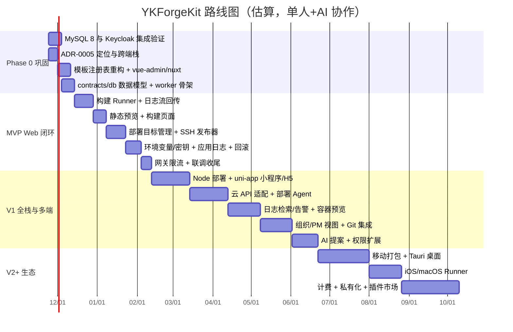

# YKForgeKit 路线图

状态：草案（Proposed）  
日期：2026-11-19

> 本文档为规划，不代表功能已实现；现状以代码和各功能文档为准。已实现能力的细节请参阅 [../project-members.md](../project-members.md)、[../../adr/0004-identity-authorization-foundation.md](../../adr/0004-identity-authorization-foundation.md)、[../../architecture/blueprint.zh-CN.md](../../architecture/blueprint.zh-CN.md) 等文档。本文与 [00-product-vision.md](./00-product-vision.md)、[01-capability-map.md](./01-capability-map.md)、[02-technical-architecture.md](./02-technical-architecture.md)、[04-open-questions.md](./04-open-questions.md) 互为配套。

## 0. 阅读须知

- **现状基线**：仓库为 pnpm monorepo（Node 22+、TypeScript），已实现 [apps/console](../../../apps/console)、[apps/api](../../../apps/api)、[packages/contracts](../../../packages/contracts)、[packages/project-core](../../../packages/project-core)、[packages/asset-core](../../../packages/asset-core)、[packages/cli](../../../packages/cli)、[packages/identity-core](../../../packages/identity-core)、[packages/db](../../../packages/db)，规划基线记录为 115 个单元测试通过；CI 已配置 MySQL 8 集成测试，真实 Keycloak 端到端验证仍待完成。当前 `project-core` 仅有 `vue-web` 一个模板，`asset-core` 仅内置 `official.theme` 一个资产，`AUTH_MODE` 支持 `local`/`oidc`。
- **实施范围**：以下按阶段列出交付范围、实施顺序与验收条件。B08–B12 已实现模板构建、实时构建日志、静态产物预览与 SSH 静态发布/回滚（见 [SSH 部署](../ssh-deploy.md)，真实 Docker sshd 验证由独立 CI 执行）；应用在线日志、AI、计费、组织与多端模板仍按后续阶段推进。现有创建向导（`/projects/new`）在浏览器预览文件计划，通过 API 登记项目配置。本地工程文件由 `forgekit create` 生成。
- **估算口径**：所有工期均为“单人 + AI 协作”的粗估，含设计、编码、测试、文档，不含外部等待（如 ICP 备案、云账号审批、平台审核）。实际以迭代中复盘为准。
- **总体风险**：范围过大是最大风险（见各阶段“主要风险”与 [04-open-questions.md](./04-open-questions.md)）。本路线图的核心策略是**先收窄到 Web 类项目闭环**，再逐步扩展多端与运维能力。

## 1. 阶段总览

| 阶段 | 主题 | 粗估工期（估算） | 核心产出 |
| --- | --- | --- | --- |
| Phase 0 | 巩固现有代码 | 2–3 周 | MySQL 8 与 Keycloak 集成验证、定位与跨端 ADR、模板注册表重构、数据模型起步 |
| MVP | Web 项目“从想法到上线”闭环 | 8–10 周 | 云端构建、静态预览、SSH 部署到自有云主机、域名+HTTPS、环境变量、回滚、在线日志 |
| V1 | 全栈与多端扩展、运维增强、协作与 AI | 3–4 个月 | Node/全栈部署、uni-app 小程序+H5、云 API 适配、部署 Agent、日志检索与告警、PM 视图、AI 提案、Git 集成 |
| V2+ | 移动打包、桌面、计费、私有化、生态 | 待定（估算 4–6 个月+） | App 打包签名、Tauri 桌面、iOS/macOS Runner、计费、私有化部署、插件市场、桌面客户端 |

> 时间线为估算，详见第 3 节 mermaid 甘特图。

## 2. 各阶段详述

### Phase 0：巩固现有代码（约 2–3 周，估算）

**目标**：验证现有身份与项目协作链路，确认产品定位和跨端技术栈，并为 MVP 准备模板、数据模型和构建队列。

**范围（做）**

- 验证 MySQL 8 与 Keycloak 集成（Docker 环境），修复暴露的问题；覆盖成员/邀请/审计/限流与 OIDC 登录链路。
- 产出 ADR-0005：产品定位与跨端技术栈决策（uni-app + Tauri 2 + Nuxt），并将 ADR-0002（Vue 优先）转为 Accepted。
- 完善旧项目认领与迁移流程，验证生产环境强制 OIDC 的现有配置，并补足相关测试。
- `project-core` 模板注册表重构：支持多模板 + 模板元数据（类型、目标端、能力），为后续模板扩展打基础。
- 新增 `vue-admin` 后台管理模板、`nuxt` 内容站模板（博客/个人站/官网 SSG）。
- `contracts` + `db`：`environments`、`deploy_targets`、`builds`、`deployments` 数据模型与迁移（0008 起）。
- `apps/worker` 骨架 + Redis/BullMQ + 构建任务状态机（排队/运行/成功/失败/取消）。

**范围（不做）**

- 不做真实构建执行、不做预览、不做部署、不做日志流。
- 不引入组织/多租户、AI、计费。
- 不新增移动/桌面/小程序模板（仅完成注册表与 Web 模板）。

**退出标准（可验证）**

1. CI 中 MySQL 8 + Keycloak 集成测试稳定通过（连续多次运行无 flaky），并记录覆盖的接口清单。
2. ADR-0005 合入，ADR-0002 状态改为 Accepted；[docs/architecture/blueprint.zh-CN.md](../../architecture/blueprint.zh-CN.md) 与之一致。
3. 生产模式（`AUTH_MODE=oidc`）下，无有效令牌的请求被拒绝，且有测试覆盖。
4. `project-core` 模板注册表可枚举 ≥3 个 Web 模板（`vue-web`、`vue-admin`、`nuxt-site`），每个模板带元数据；`create` 命令可用新模板生成工程并通过构建冒烟测试。
5. 迁移 0008+ 可在空库与已有库上幂等执行；`builds`/`deployments` 表结构评审通过。
6. `apps/worker` 能消费一个“空构建”任务并正确流转状态机，状态可查询。

**主要风险**

- 集成测试暴露既有设计缺陷，修复可能超出 2–3 周（预留缓冲）。
- 模板注册表重构触及 `project-core` 公共 API，需同步 `cli` 与 `contracts`，注意兼容。
- 单人带宽：Phase 0 与 MVP 边界需严格，避免提前做构建执行。

---

### MVP：Web 项目“从想法到上线”闭环（约 8–10 周，估算）

**目标**：让一个 Web 类项目（后台管理、个人站/博客、企业官网、工具站）在平台上完成“生成 → 云端构建 → 静态预览 → SSH 部署到用户自有阿里云/腾讯云主机 → 域名+HTTPS → 在线看日志 → 版本回滚”的完整闭环。开发者可控、可改源码、可脱离平台。

**范围（做）**

- 在 Phase 0 的基础上，将 Web 模板总数扩展至 3–4 个（Vue 后台管理、个人站/博客 SSG、企业官网、Vue SPA 工具站）。
- 源码交付：由本地 `forgekit create` 生成工程，规划支持下载。GitHub/Gitee 推送待 D-06 确认。
- 云端构建：`apps/worker` 调度 Docker 隔离 Runner（非 root、资源限制、只读基础镜像、无控制面数据库访问、出网白名单），执行 `pnpm install/build`，日志流回传。
- 产物存储：本地磁盘或 MinIO 抽象（Artifact Store 接口）。
- 静态预览：构建产物上传预览存储，按项目+构建号通过 `*.preview` 子域访问，带访问令牌/过期时间。
- 部署目标管理（B12 已实现用户本机生成的专用密钥导入、加密存储和主机公钥固定；平台生成/独立连通性检查仍是后续规划）：添加 SSH 主机（平台生成密钥对、连通性检查、主机指纹固定）+ 加密密钥存储。
- SSH 发布器（B12 已实现静态上传、原子切换、保留和手动回滚；Web 服务配置及健康自动回滚仍待实现）：上传产物到 `releases/<id>`、原子切换 `current` 软链接、Nginx/Caddy 托管静态站、健康检查失败自动回滚、保留最近 N 个版本可一键回滚。
- 域名+HTTPS：Caddy 自动证书或 acme.sh（Let's Encrypt）；提示中国大陆主机绑定域名需 ICP 备案。
- 环境变量/密钥：信封加密（主密钥来自 KMS 或部署环境）、只写不读、按环境（dev/staging/prod）区分、部署时注入、审计。
- 在线日志：构建日志、部署日志实时流（SSE/WebSocket）+ 通过 SSH 拉取应用日志（journald/docker logs/文件 tail），只读、限速、保留短期。
- 控制台新增：构建、预览、部署、日志、部署历史页面；复用已实现的 owner/editor/viewer 角色，新增 `build:run`、`deploy:*`、`secret:write`、`log:read` 等权限。
- 公网开放前完成网关限流（见[身份与授权 ADR](../../adr/0004-identity-authorization-foundation.md)和[项目邀请](../project-invitations.md)）。

**范围（不做）**

- 不做 Node/全栈项目部署（仅静态站）、不做容器预览环境（仅静态产物预览）。
- 不做小程序/移动/桌面模板与打包。
- 不做云厂商 API 适配（仅 SSH 方式）、不做部署 Agent。
- 不做 AI、计费、组织或多租户、PM 视图及深度 Git 托管集成。源码交付以本地 CLI 和下载为主，可选的 GitHub/Gitee 推送见 [D-06](./04-open-questions.md#1-需要用户决策的问题)。
- 不做日志检索与告警（仅实时流 + 短期拉取）。

**退出标准（可验证）**

1. 从控制台使用 4 个 Web 模板之一登记项目，以对应的标准工程触发云端构建，构建成功并产出可下载产物；构建失败时日志可定位原因。
2. 构建成功后生成带令牌、有过期时间的预览链接，可访问且过期后失效。
3. 添加一台阿里云 ECS（或腾讯云 CVM/轻量）作为部署目标，完成连通性检查与主机指纹固定；执行部署后站点可通过域名+HTTPS 访问。
4. 部署健康检查失败时自动回滚到上一版本；控制台可一键回滚到最近 N 个版本之一。
5. 环境变量按环境注入生效，控制台不可读回明文，审计记录可查。
6. 构建日志、部署日志实时可见；应用日志可通过 SSH 拉取查看（只读、限速）。
7. 成员角色在构建/部署/日志操作上按 `identity-core` 策略生效（默认拒绝）。
8. 网关限流上线并有测试覆盖。

**主要风险**

- **构建沙箱安全**（最大技术风险）：Docker 隔离不足需评估 gVisor/Kata/firecracker，MVP 先以严格配置 + 出网白名单缓解。
- **云凭证/SSH 私钥泄露**：坚持平台生成密钥对、用户只加公钥、信封加密、最小权限、审计。
- **SSH 部署的异构性**：不同发行版/权限/端口差异，需明确支持矩阵与失败诊断。
- **ICP 备案与域名**：属外部依赖，需在文档中明确前置条件，避免用户预期落差。
- **范围蔓延**：Node 部署、容器预览和部署 Agent 留待 V1。

---

### V1：全栈与多端扩展、运维增强、协作与 AI（约 3–4 个月，估算）

**目标**：从“静态 Web 闭环”扩展到“全栈 + 多端 + 可运维 + 可协作 + AI 辅助”，并引入云厂商 API 适配与轻量部署 Agent。

**范围（做）**

- Node/全栈项目部署：`nest-api` 等模板，systemd 或 Docker Compose 管理进程，反向代理 Node 服务。
- uni-app 小程序 + H5：`uni-app` 模板；小程序上传用官方 CI 工具（微信 `miniprogram-ci`、支付宝 `minidev`），提审需用户自己的平台账号与密钥；小程序体验版二维码预览。
- 云厂商 API 适配：先实现 `adapters/deploy-aliyun`，再实现 `adapters/deploy-tencent`（`@alicloud/*` OpenAPI、`tencentcloud-sdk-nodejs`），能力含列实例、云助手（阿里云云助手/腾讯云 TAT）免 SSH 下发命令、安全组端口检查、DNS（阿里云解析/DNSPod）自动解析、证书服务；使用 RAM/CAM 子账号 AccessKey 最小权限或 STS 临时凭证。
- 轻量部署 Agent（`apps/agent`，单二进制，主动出站 WebSocket/HTTPS，无需开放入站端口），负责部署、日志采集、指标；mTLS + 一次性注册令牌。
- 日志检索与告警：部署 Agent 采集 → 平台存储（推荐 Loki 或阿里云 SLS/腾讯云 CLS 适配）按时间/关键词搜索；基础监控（CPU/内存/磁盘/HTTP 探活）、告警（邮件/企业微信/钉钉/飞书 webhook）。
- 容器预览环境（PR/分支预览，闲置自动回收）。
- 协作：组织/团队、更细权限（`deploy:prod` 需审批）、PM 视图（需求清单/任务看板关联 Git 提交/PR、里程碑进度、预览链接汇总、发布记录、发布审批）。
- Git 托管集成：关联 GitHub、Gitee、GitLab、Codeup、CODING 等托管平台的提交和 PR。在 MVP 计划的基础源码交付上扩展，首选平台见 [D-06](./04-open-questions.md#1-需要用户决策的问题)。
- AI 辅助：自然语言 → 模板+资产+页面/配置的“变更提案”（diff 可审查后应用，复用资产 Installer Planner 的计划/确认模式）；模型提供商适配（DeepSeek、通义千问、OpenAI 兼容接口），用户可自带 Key；非技术用户模式 AI 帮写文案、生成页面区块、解释报错日志。AI 只产出提案，不直接改主分支。
- 在 MVP 构建、部署、密钥和日志权限的基础上扩展审批与组织权限，并让 `asset-core` 支持多目标资产。

**范围（不做）**

- 不做移动 App 打包签名、Tauri 桌面打包（V2+）。
- 不做 iOS/macOS Runner（V2+）。
- 不做计费、私有化部署、插件市场、桌面客户端（V2+）。
- 不做 APM/错误追踪（V2+）。

**退出标准（可验证）**

1. 一个 `nest-api` 项目可部署到自有主机并以 systemd/Docker Compose 运行，健康检查与回滚生效。
2. 一个 `uni-app` 项目可构建 H5 并生成小程序体验版二维码（至少微信），上传链路在测试账号下跑通。
3. 阿里云适配器可完成“列实例 + 云助手下发命令 + 安全组检查 + DNS 解析”最小闭环；腾讯云适配器至少完成列实例与云助手。
4. 部署 Agent 可注册、上报日志与基础指标；日志可按时间/关键词检索；告警可送达至少一种 webhook。
5. 组织/团队与 `deploy:prod` 审批生效；PM 视图可展示需求/任务/预览链接/发布记录。
6. AI 提案可生成 diff 并经审查后应用，不直接改主分支；至少支持一个模型提供商 + 自带 Key。
7. 新增权限在 `identity-core` 有测试覆盖，默认拒绝策略不变。

**主要风险**

- **多端生态锁定**（DCloud/uni-app）与平台政策/审核不确定性。
- **云 API 适配的广度**：两家云、多产品线，易失控，需按“最小闭环”逐项交付。
- **部署 Agent 安全**：mTLS、注册令牌、出站模型需严格设计，避免成为新攻击面。
- **AI 提案的可靠性与成本**：坚持“提案 + 审查”，用户自带 Key 降低平台成本与合规压力。
- **范围仍偏大**：V1 内容多，需按 backlog 逐 PR 推进，允许部分能力顺延 V2+。

---

### V2+：移动打包、桌面、计费、私有化、生态（估算 4–6 个月+）

**目标**：补齐移动 App 打包签名、Tauri 桌面、iOS/macOS Runner、计费与私有化部署、插件市场/第三方资产、桌面客户端，形成可持续的产品与生态。

**范围（做）**

- 移动 App 打包签名（Android；iOS 视开发者账号与 Mac 构建机就绪情况）。
- Tauri 2 桌面（Windows/macOS/Linux），复用 Vue Web/H5 构建；需要 Node 生态深度集成时 Electron 作备选。
- iOS/macOS Runner（自建 Mac mini 或云 Mac）。
- 计费/配额：免费额度（项目数、构建分钟、预览存储、日志保留天数），按构建分钟/存储/AI token 计量；用户通过自有云账号支付云资源费用。
- 私有化部署版本。
- 插件市场/第三方资产；独立公共 UI 仓库 `yk-forge-ui`（若采纳）。
- Tauri 2 桌面客户端；Nuxt 官网/文档站。
- APM、错误追踪（Sentry 兼容）。

**范围（不做）**

- 不引入微服务/K8s/服务网格（遵循蓝图原则，模块化单体优先）。
- 不承诺“一份 UI 代码无条件完美兼容所有平台”。

**退出标准（可验证）**

1. Android App 可打包签名并产出可安装包；iOS 在账号与 Runner 就绪后可打包。
2. Tauri 桌面应用可在至少两个平台构建产出安装包。
3. 计费数据模型落地，免费额度与计量可查询；私有化部署包可独立安装运行。
4. 插件市场可上架/安装至少一个第三方资产，走资产协议与锁文件。
5. APM/错误追踪可接入并展示基础数据。

**主要风险**

- 移动/桌面打包的平台政策、签名证书、Mac 构建机成本。
- 计费与私有化的合规、数据隔离、运维复杂度。
- 生态冷启动（插件市场、第三方资产）。

## 3. 里程碑时间线（估算）

> 甘特图为估算示意，日期以 Phase 0 启动日（2026-11-24）为锚点。图中保留各任务的估算天数与示意依赖，阶段工期采用第 1 节的粗估，实际排期随迭代调整。

## 4. 近期待办（Backlog）

按优先级排列，每项一个 PR 粒度。规模：S（≤2 天）、M（3–5 天）、L（6–10 天），均为估算。

| 编号 | 标题 | 目标 | 主要改动（目录/模块） | 验收标准 | 依赖 | 规模 |
| --- | --- | --- | --- | --- | --- | --- |
| B01 | 验证 MySQL 8 与 Keycloak 集成 | 在 Docker 环境验证成员/邀请/审计/限流与 OIDC 链路 | [packages/db](../../../packages/db)、[apps/api](../../../apps/api)、[compose.test.yml](../../../compose.test.yml)、[compose.oidc.dev.yml](../../../compose.oidc.dev.yml)、CI | 集成测试在 CI 稳定通过，覆盖接口清单入文档 | 无 | L |
| B02 | ADR-0005 产品定位与跨端技术栈 | 锁定 uni-app + Tauri 2 + Nuxt 决策，ADR-0002 转 Accepted | [docs/adr/](../../adr)、[docs/architecture/blueprint.zh-CN.md](../../architecture/blueprint.zh-CN.md) | ADR-0005 合入，ADR-0002 状态更新，蓝图一致 | 无 | S |
| B03 | 旧项目认领与迁移及生产 OIDC 验证 | 完善迁移流程，验证生产认证配置 | [apps/api](../../../apps/api)（auth）、[packages/identity-core](../../../packages/identity-core)、文档 | 生产环境拒绝 local 模式，受保护接口拒绝无有效令牌的请求，相关行为有测试覆盖；迁移流程有文档 | B01 | M |
| B04 | project-core 模板注册表重构 | 支持多模板 + 元数据（类型、目标端、能力） | [packages/project-core](../../../packages/project-core)、[packages/contracts](../../../packages/contracts)、[packages/cli](../../../packages/cli) | 可枚举 ≥3 模板，`create` 用新模板生成并冒烟构建 | B02 | M |
| B05 | 新增 vue-admin 后台管理模板 | 后台管理类项目模板 | [packages/project-core](../../../packages/project-core)（模板）、[packages/contracts](../../../packages/contracts) | 生成工程可构建，元数据正确 | B04 | M |
| B06 | 新增 nuxt-site 内容站模板 | 博客/个人站/官网 SSG 模板 | [packages/project-core](../../../packages/project-core)（模板）、[packages/contracts](../../../packages/contracts) | 生成工程可 SSG 构建，元数据正确 | B04 | M |
| B07 | contracts + db 数据模型与迁移 | `environments`、`deploy_targets`、`builds`、`deployments` | [packages/contracts](../../../packages/contracts)、[packages/db](../../../packages/db)（迁移 0008+） | 空库/已有库幂等迁移，结构评审通过 | B01 | M |
| B08 | worker 骨架 + BullMQ + 构建状态机 | 已实现 [空构建编排与 API](../worker-build-queue.md)，真实 Runner 留待 B09 | `apps/worker`、[packages/contracts](../../../packages/contracts)、[apps/api](../../../apps/api) | 空构建任务状态机正确流转，状态可查询 | B07 | M |
| B09 | Docker 隔离 Runner（Web 构建） | 已实现 [Docker Runner 与本地制品](../docker-build-runner.md)；模板取材，安装默认禁网/可接 registry 代理，构建禁网 | `apps/worker`（Runner/Artifact Store）、project-core 模板构建元数据 | 非 root/资源限制/只读镜像；提供安全制品读取接口，HTTP 预览由 B11 提供；生产出网白名单需宿主落实 | B08 | L |
| B10 | 构建日志实时流 API + 控制台构建页 | SSE 实时日志与控制台页面 | [apps/api](../../../apps/api)、[apps/console](../../../apps/console)、[packages/contracts](../../../packages/contracts) | 构建日志实时可见，页面可触发/查看构建 | B09 | M |
| B11 | 静态预览服务 | 已实现 [独立 host 静态预览](../preview-links.md)，成功构建的令牌链接、过期与撤销 | [apps/api](../../../apps/api)、[apps/console](../../../apps/console)、存储抽象 | 预览链接可访问，过期失效 | B09 | M |
| B12 | SSH 静态部署与目标管理（已实现指定范围） | 专用密钥导入/加密、主机公钥固定、静态上传/原子切换、保留/手动回滚、部署日志；[实现边界](../ssh-deploy.md) | [apps/api](../../../apps/api)、[packages/db](../../../packages/db)、[packages/contracts](../../../packages/contracts)、[apps/console](../../../apps/console) | 目标权限/密文、部署/回滚/保留、SSE 与本地 Docker sshd CI（本地未运行真实容器） | B07、B09–B11 | L |
| B13 | SSH 发布运维增强（剩余规划） | B12 已含 `releases/current` 和手动回滚；后续 Caddy 配置、Web 健康检查与自动回滚 | `adapters/deploy-ssh`、[apps/api](../../../apps/api)、`apps/worker` | 部署成功可访问；健康检查失败自动回滚；一键回滚 | B12、B09 | L |
| B14 | 环境变量/秘密值管理（已实现 MVP） | 复用 B12 AES-GCM、秘密只写、按环境、审计、构建注入与私有主机 .env；[边界说明](../environment-variables.md) | [apps/api](../../../apps/api)、[packages/db](../../../packages/db)、[packages/contracts](../../../packages/contracts)、[apps/console](../../../apps/console) | 注入生效，不可读回明文，审计可查 | B07 | M |
| B15 | 在线应用日志 + 部署历史页 | SSH tail 限速只读 + 部署历史页面 | [apps/api](../../../apps/api)、[apps/console](../../../apps/console)、`adapters/deploy-ssh` | 应用日志可查看（只读限速）；部署历史可查可回滚 | B13 | M |

> 说明：B01–B08 属 Phase 0，B09–B15 属 MVP。V1/V2+ 的 backlog 在对应阶段启动前细化，避免过早锁定细节。

## 5. 与架构原则的一致性说明

- 本路线图严格遵循“成熟稳定优先、模块化单体、不立即引入微服务/K8s/服务网格”的蓝图原则，V2+ 亦不引入微服务。
- Web 使用 Vue 3 + Vite 或 Nuxt，小程序、移动 App 和 H5 使用 uni-app，桌面使用 Tauri 2。跨端共享业务逻辑和设计 Token，UI 按端适配。
- 待用户决策项（SaaS vs 私有化、控制面部署位置、MVP 先支持哪家云、组件库选型、Git 托管首选、AI 模型与费用、非技术用户模式优先级、商业化、许可证、旧 PR 处理、域名与 ICP、iOS 账号与 Mac 构建机）见 [04-open-questions.md](./04-open-questions.md)，本路线图不擅自定论，仅按推荐路径编排。
- 最大风险为范围过大；本路线图以“MVP 只做 Web 闭环”作为收敛手段，V1/V2+ 内容允许按实际带宽顺延。
