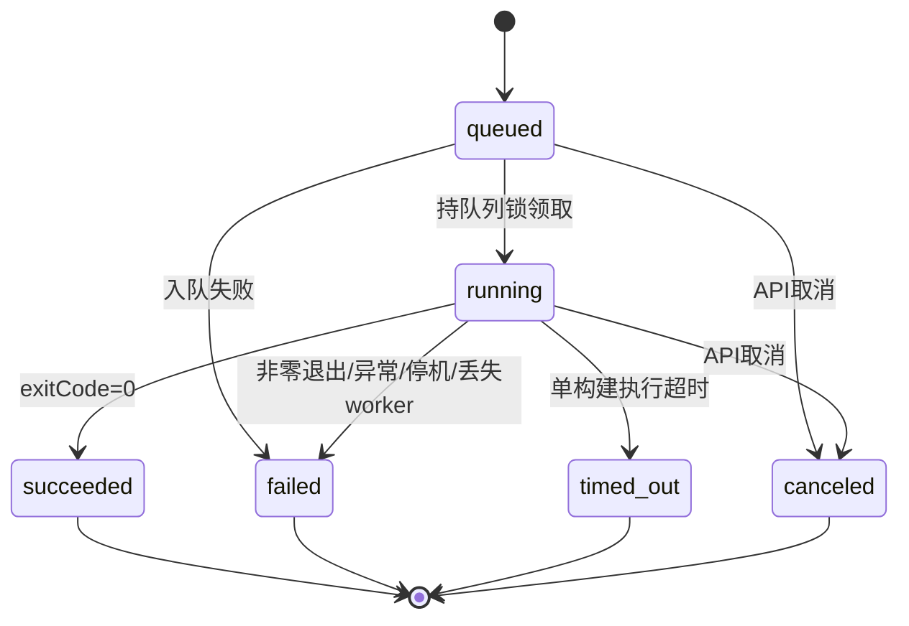

# 构建队列与 Worker（B08）

已实现构建队列闭环、状态查询、取消、MySQL 分块日志读取与审计。默认 NoopRunner 不执行源码、不产生文件；[B09 Docker Runner/ArtifactStore](./docker-build-runner.md) 可通过配置启用，支持模板静态构建。[B10 SSE/控制台构建页面](./build-console.md) 已实现，[B11 静态预览](./preview-links.md) 已提供。中文为权威，英文未翻译，公开发布前须补齐。决策见 [ADR-0008](../adr/0008-worker-build-queue.md) 与 [ADR-0009](../adr/0009-build-and-preview-security-model.md)，持久化语义见 [B07 数据模型](./build-data-model.md)。

## 架构与契约

`apps/api` 的 NestJS 控制器授权并调用 B07 BuildRepository 创建记录；BuildQueueService 使用 BullMQ 入队。`apps/worker` 是 Node 22 普通进程：启动组合消费者、BuildProcessor、B07 仓库和 Runner，无 HTTP 服务或 Nest 容器，因此无需框架生命周期。编排逻辑可用 fake repository/runner 独立测试。

- 队列名 `builds`，job name `build`，jobId = buildId（UUID）；载荷严格为 `{ "buildId": "<UUID>" }`。名称与 Zod Schema 共享于 `@forgekit/contracts`。不要手动用随机 jobId 入队。
- MySQL 是状态和日志权威，任务只传 ID。消费者对终态/已删除构建无操作；业务失败/超时作为已处理任务结束，BullMQ 的 completed 表示编排完成，**不表示构建 succeeded**。
- 自动入队最多 3 次基础设施重试，指数退避起始 1 秒；保留最近 1000 个 completed/failed 任务。即使 Redis 历史被清理，同 ID 再次到达也由数据库终态保护；业务重试需新建构建记录。
- `BuildRunner.run(build, logs, signal)` 返回 `{ exitCode, artifact?, runnerInfo? }`；0 成功，其余失败；异常记录脱敏的通用错误码。NoopRunner 不读源码、不运行 shell。`BuildLogSink.write` 每次等待 B07 append，序号从 1 分配，单块 16 KiB；日志写入失败使构建失败，不静默丢日志。
- B09 提供 LocalFsArtifactStore，真实 Runner 返回的制品元数据在 running→succeeded 时写入 B07 字段。NoopRunner 仍不填写 artifact 字段；读取能力供 B11 独立预览进程使用。



所有转换调用 B07 `updateStatus` 的共享转换守卫和预期状态校验。执行计时从 running 开始；排队时间不计入超时。API 直接持久化 canceled，消费者每 250ms 读取状态并中断 Runner；queued 取消不必移除 Redis job，消费时跳过。取消与完成竞争时先提交者生效，完成后的取消返回 409；重复取消 canceled 返回原记录，不重复记审计。

## 恢复与停机

启动和每次健康心跳补投递 queuedAt 超过 30 秒的 queued 行，每批最多 100 条，按时间排序，以固定 jobId 去重。覆盖数据库提交后、Redis 入队前崩溃。入队明确失败返回 503 并尝试 queued→failed；超时后 Redis 实际已收到任务也受同一 CAS 保护。已在 Redis 永久 failed/completed 但仍 queued 的记录经守卫转 failed，避免失败任务去重导致永远排队。此实现不是事务 outbox，高吞吐下补投递延迟受批次限制。

running 的恢复以 BullMQ 独占锁为前提，不能在副本启动时批量失败其他进程的任务。锁默认约 30 秒过期，stalled 扫描后任务重新被领取，处理器见 running 就写 failed/worker_lost，不重复执行。默认最多一次 stalled 重领；如果 Redis job 已永久 failed/completed 或丢失，心跳扫描超过执行超时 + 60 秒的 running 行并写 failed（每批 100 条）。因此恢复依赖 Redis/MySQL 可用和至少一个健康 worker；Redis 丢失时 queued 可以补投，running 会延后失败。保留 Redis 数据、开启适当持久化并设置 `maxmemory-policy=noeviction`。

SIGINT/SIGTERM 时先暂停本 worker 的队列接收（不等待活跃任务），再中断当前 Runner，running→failed；等待进行中的心跳、Runner 清理及活跃任务结束后关闭消费者与数据库。取消、超时或停机触发 AbortSignal 后，处理器始终等待 Runner promise 完成，期间保留并发槽位和队列锁续租；数据库终态可能先于资源清理完成。Runner 必须在清理资源后才完成 promise；不响应中断或无法完成清理会阻塞任务释放和停机。B09 Docker Runner 实现了响应信号的容器 kill/rm 和工作目录清理；强杀/daemon 故障后的运维边界见其指南。worker 不在控制面执行用户代码。连接失败会重连，健康日志不可用时应告警。

## 配置

| 环境变量 | 默认/行为 |
| --- | --- |
| DATABASE_URL | MySQL 连接串，格式与 API 一致；worker start 必填 |
| REDIS_URL | `redis://` 或 `rediss://`，可带账号密码、端口和数字库号；不接受 query/hash；worker start 必填 |
| WORKER_CONCURRENCY | 默认 2，整数 1–32；每进程并发数 |
| BUILD_TIMEOUT_MS | 默认 600000（10 分钟），整数 1–3600000；每个构建独立计时 |
| WORKER_HEARTBEAT_MS | 默认 30000，整数 1–300000；健康检查和补投递周期 |

API 可以缺省 REDIS_URL 启动，触发时 503、不会创建构建。非空无效地址使启动失败；首次触发才连接 Redis，连接/命令有超时，失败响应不包含连接串。worker start 配置不完整或服务在 10 秒启动窗口内不可用时失败退出；worker dev 在未填 MySQL/Redis 地址时打印 `worker_disabled` 并等待源码变更，不阻碍其他应用开发。

开发入口先读取 worker、API、仓库根目录的 `.env`（按此顺序，已有进程变量优先；可用 `DOTENV_CONFIG_PATH` 指定文件）。如果 API 已配置部署加密密钥但缺少 `FORGEKIT_ARTIFACT_DIR`，仅开发入口跳过部署消费者并输出 `deploy_worker_disabled`，构建等其他消费者继续启动；配置绝对路径制品目录并重启后才能消费部署任务。显式配置的无效目录仍导致启动失败。生产入口不读取这些开发文件，也不会跳过部署配置校验，仍须显式注入所需变量。

worker 输出 JSON `worker_ready`、`worker_heartbeat`（ok/unavailable）、`job_processed`、`job_failed`、`worker_error`、`queue_error`。心跳检查 MySQL、Redis 并补投递，记录并发数；无 HTTP health 端口。启动、关闭、队列错误及补偿失败的诊断包含脱敏后的异常消息、堆栈和 cause，屏蔽 URL 用户信息、配置密码、密钥和令牌；不输出原始构建内容或驱动配置对象。构建结果应查询 MySQL/API；部署时按心跳缺失和 unavailable 告警。

## API

统一前缀 `/api/v1`，项目参数为 UUID（现有项目详情仍按 slug）。读操作沿用 ProjectApiGuard 和成员校验；owner/editor 可触发/取消，viewer 可读，非成员 404，角色不足 403，无令牌 401。local 模式保留现有本地只读能力，但触发/取消要求 OIDC 成员，不伪造触发者。

| 方法与路径（相对 /api/v1） | 参数与结果 |
| --- | --- |
| POST /projects/:id/builds | 严格 JSON `{ "sourceRef": "template:vue-web" }`；1–1024 字符；template 取项目记录，触发者取认证身份；201 返回 Build；Docker 仅支持对应模板引用 |
| GET /projects/:id/builds | `beforeNumber` 排他游标，`limit` 默认 50、1–1000；构建号倒序数组 |
| GET /projects/:id/builds/:buildId | 完整 Build，时间为 ISO UTC |
| POST /projects/:id/builds/:buildId/cancel | 空请求或 `{}`；201 返回取消后的 Build |
| GET /projects/:id/builds/:buildId/logs | `seq` 默认 0（严格大于）、`limit` 默认 500、1–1000；日志块升序数组 |

列表下一页传最后一条 number；日志下一页传最后一条 seq，空数组表示暂时没有新日志。跨项目 buildId 一律 404。API 持久化 sourceRef 而不抓取源码；B09 Docker 模式只接受与项目模板一致的 `template:<模板ID>`（例如 `template:vue-web`），使用当前模板重建，不是不可变快照。快照/Git 引用尚未实现，在 Docker 模式会失败；不能把它直接当本地路径或 shell 命令。

触发、取消分别按 OIDC 身份限流 30 次/小时、60 次/小时，跨 API 实例共享已有原子计数表的独立配额，超额 429。迁移 0009 的 build_audit 保存 triggered/canceled、项目、构建和操作者 ID，与创建/取消同事务；无变化取消不重复记录。保留期/清理策略同已有审计计数表，尚未提供自动清理任务。

## 本地运行与验证

```bash
corepack pnpm install
# 使用独立测试库/Redis，填写测试用密码（见 .env.test.example）
docker compose -p forgekit-integration --env-file .env.test -f compose.test.yml up -d --wait
set -a
. ./.env.test
set +a
corepack pnpm db:test:integration
corepack pnpm build
corepack pnpm --filter @forgekit/worker start
# 另一终端继承同样的 DATABASE_URL / REDIS_URL：
# 参照 keycloak-development.md 的 OIDC 配置启动 API，POST 上述接口触发空构建。
```

认证配置见 [本地 Keycloak](./keycloak-development.md)。取得已有项目 UUID 和有效 API access token 后，可用 `curl -X POST "http://127.0.0.1:3001/api/v1/projects/$PROJECT_ID/builds" -H "Authorization: Bearer $ACCESS_TOKEN" -H "Content-Type: application/json" -d '{"sourceRef":"snapshots/noop-dev"}'` 触发，再按上表轮询状态和日志。

日常使用现有本地 MySQL 和 Redis 时，参照 `.env.example` 配置环境变量后运行根 `corepack pnpm dev`（包含 API、console、worker）；单独 `corepack pnpm --filter @forgekit/worker dev` 运行 worker。开发入口按顺序读取 `apps/worker/.env`、API 使用的 `apps/api/.env`、仓库根 `.env`；仅补充尚未设置的变量，进程环境优先。设置 `DOTENV_CONFIG_PATH` 时仅读取指定文件。`NODE_ENV=production` 不自动读取文件；生产 `start` 始终要求显式注入环境变量，也不使用 dev 的缺省跳过机制。`compose.test.yml` 的 Redis 7 仅绑定 36379 回环端口、无持久卷，供测试/本地临时开发；不可作为生产持久化配置。

默认 `corepack pnpm test` 跑 fake repository/runner 状态机与 HTTP 权限/参数测试，跳过外部服务集成。显式真实集成入口：

```bash
export FORGEKIT_DB_INTEGRATION=1 FORGEKIT_WORKER_INTEGRATION=1
# DATABASE_URL 须为回环 3306/33306 的 forgekit_test 账号与同名库
export REDIS_URL=redis://127.0.0.1:36379/15
corepack pnpm --filter @forgekit/api exec vitest run test/build-queue.integration.test.ts
```

集成测试经真实 API service/producer → BullMQ → worker → MySQL 验证成功、日志序号、审计、重复投递、重启恢复、漏投补偿和取消。仅允许回环 Redis 6379/36379 的 DB 15；测试不 flush 队列/数据库，只删除本次 UUID job/记录。CI mysql-integration 配置 Redis 7 服务并显式开启用例。无需 Docker 时可使用临时目录中的真实 Redis/MySQL 二进制，结束时只停止自己创建的进程 PID。
